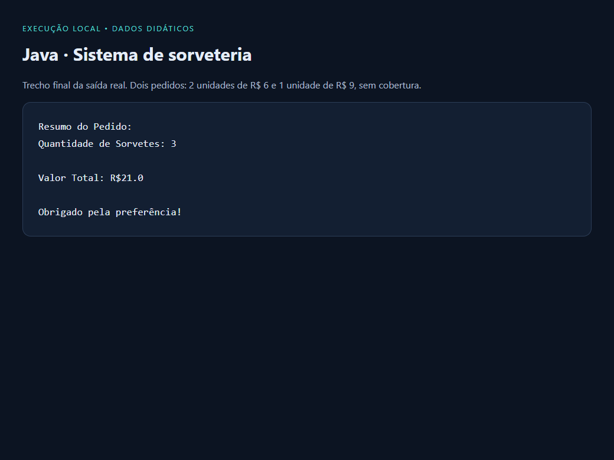
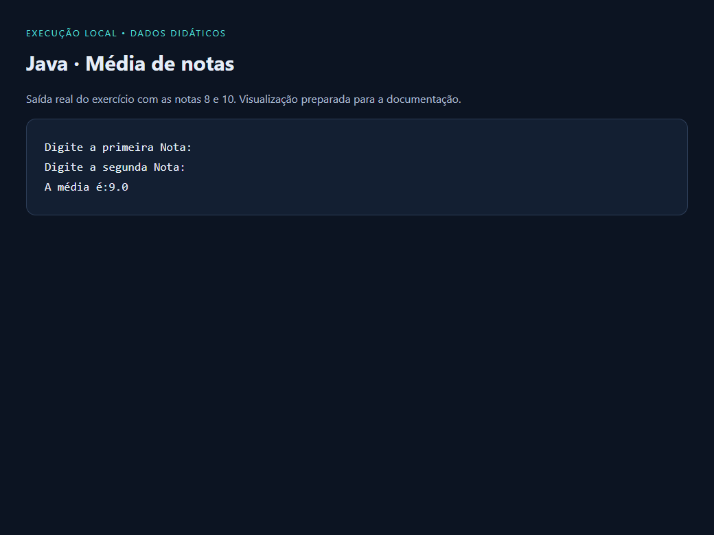

# Java · Fundamentos de programação

Dois programas de terminal para praticar entrada de dados, decisões, repetição e cálculos em Java. O repositório registra exercícios de aprendizagem com exemplos que podem ser compilados e executados separadamente.

**Tipo:** estudos de lógica · **Interface:** terminal · **Tecnologia:** Java, sem bibliotecas externas.

## O que está implementado

| Programa | Objetivo | Conceitos praticados |
|---|---|---|
| [Sorveteria.java](Sorveteria.java) | Montar pedidos com tipos de sorvete, quantidades e coberturas; exibir o total ao finalizar. | `Scanner`, `while`, `for`, `switch`, acumuladores e cálculos. |
| [medialuno.java](medialuno.java) | Ler duas notas e calcular a média aritmética. | Entrada numérica, variáveis e operações. |

## Demonstrações

Saídas reais capturadas durante a execução local e apresentadas em um painel de leitura para a documentação. São dados didáticos; as imagens não representam uma aplicação gráfica.

### Pedido na sorveteria

Dois pedidos sem cobertura: duas unidades de R$ 6 e uma de R$ 9. O programa soma três sorvetes e R$ 21.



### Média de duas notas

Execução com as notas 8 e 10, resultando em média 9.



## Executar

Requisito: JDK instalado, com `java` e `javac` disponíveis no terminal. Os exemplos foram conferidos com JDK 17.

```sh
javac -encoding UTF-8 -d out Sorveteria.java medialuno.java
java -cp out Sorveteria
java -cp out medialuno
```

Use números conforme solicitado no terminal. Os programas são exercícios introdutórios: não possuem persistência, interface gráfica ou validação completa de entradas inválidas.
